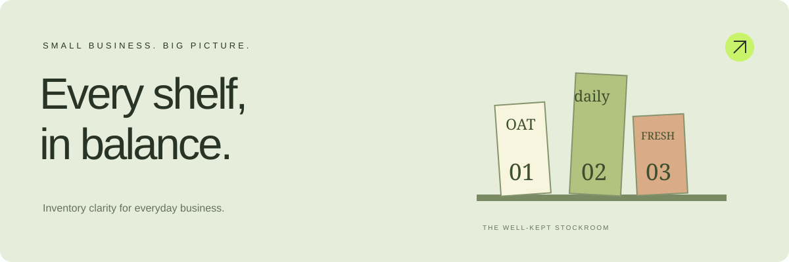
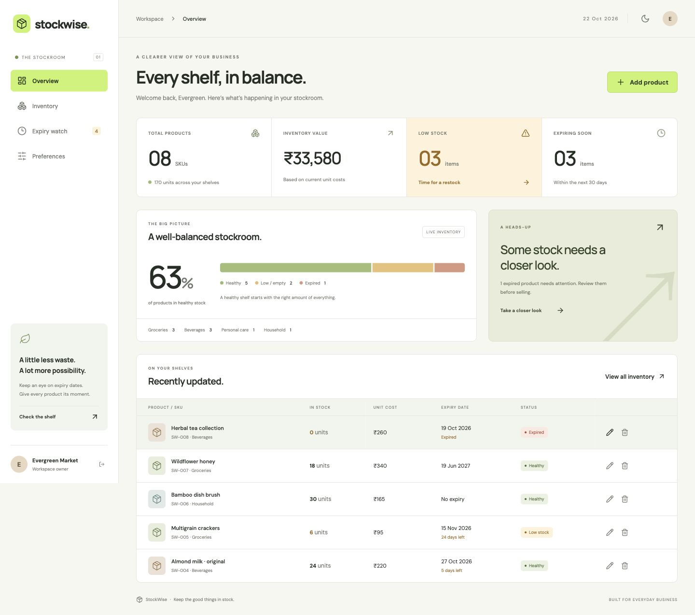
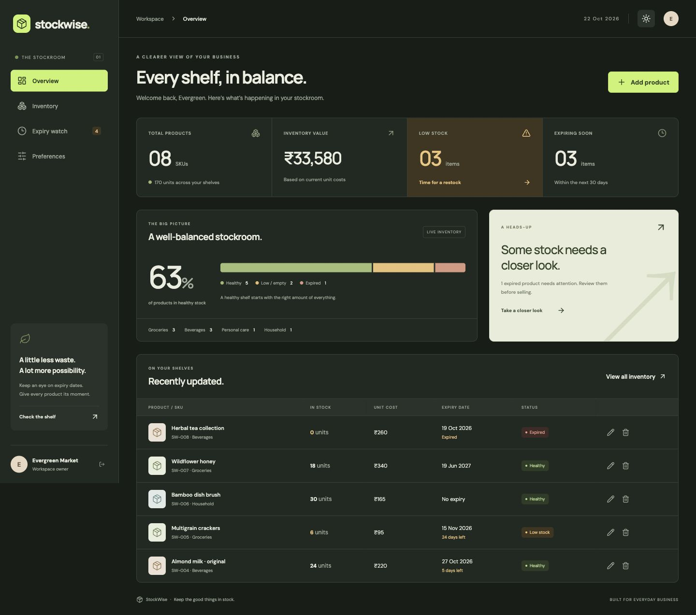
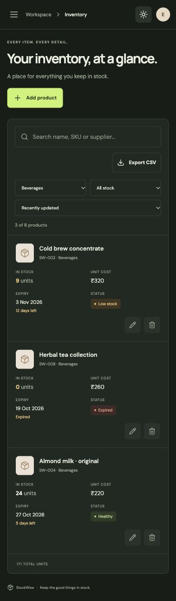
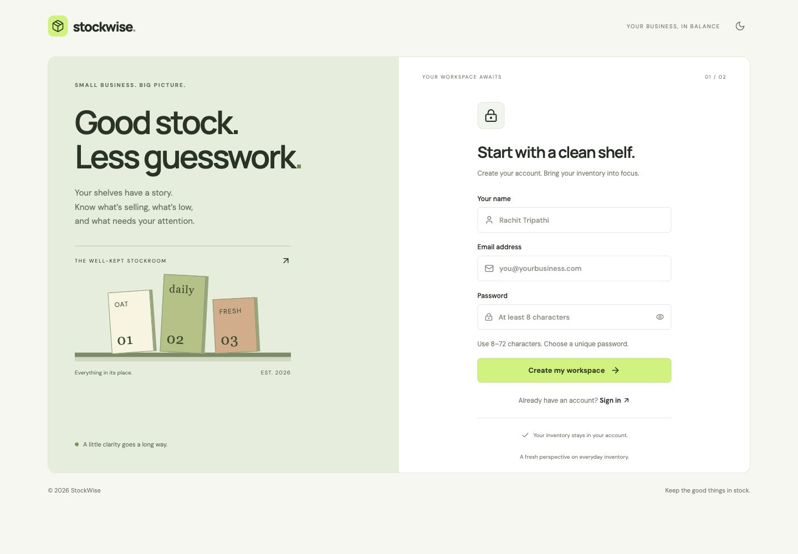
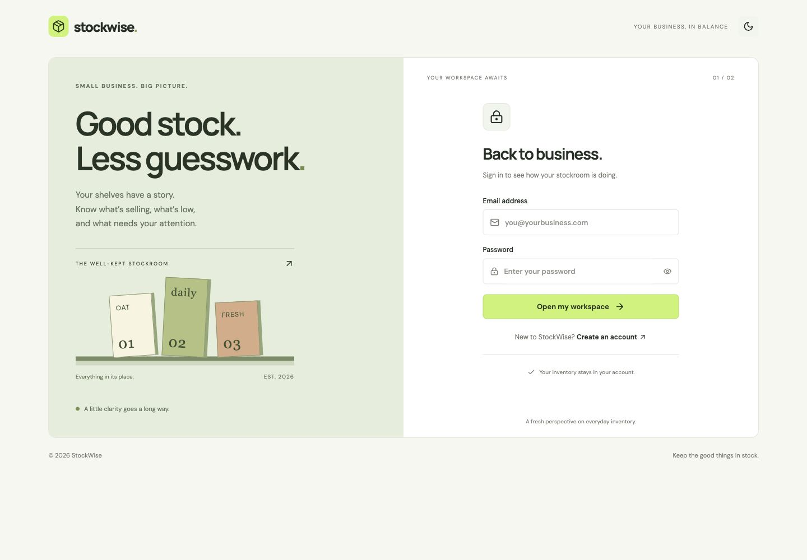

<div align="center">


# stockwise.

### Every shelf, in balance.

Inventory clarity for the small businesses that keep everyday life moving.<br>
Track stock, spot shortages, and give every product its moment before expiry.

[Live demo](https://stockwise-rachit.onrender.com) · [Explore the code](https://github.com/rachit1807/stockwise) · [Run locally](#run-locally) · [Authentication](docs/AUTHENTICATION.md) · [Verification](docs/TESTING.md)


</div>



## Why StockWise?

A small shop should not need a complicated enterprise system to know what is on its shelves. StockWise replaces scattered stock notes with a personal workspace that shows what is available, what needs restocking, and what is approaching its expiry date.

This project demonstrates **connecting a React frontend to backend authentication**, with a useful inventory workflow built around it. Registration, login, session restoration and protected routes communicate with real Express APIs. Inventory records persist in the database and belong to the signed-in account.

## The workspace

- **Account access:** validated registration and login, password visibility, loading states and useful error messages.
- **Protected routes:** backend-verified session restoration, automatic session-expiry handling, and server-side logout revocation.
- **Stockroom overview:** product count, stock units, inventory cost value, low-stock count and upcoming expiries.
- **Product management:** add, edit and remove products with SKU, category, quantity, cost, threshold, supplier and optional expiry date.
- **Inventory explorer:** name/SKU/supplier search, category and status filters, and sorting by name, quantity, expiry or latest update.
- **Expiry watch:** an ordered timeline of expired products and products expiring within 30 days.
- **CSV export:** download the currently filtered inventory, with spreadsheet formula-injection protection.
- **Sample inventory:** explicitly load eight example products into your own empty workspace.
- **Appearance:** remembered light/dark themes and currency display preferences. Currency preferences change the symbol, not the stored prices.
- **Responsive design:** desktop sidebar, mobile navigation drawer, stacked phone inventory cards, responsive forms and touch-friendly controls.
- **Accessible interactions:** semantic labels, focus indicators, dialog focus management, Escape dismissal, live feedback and reduced-motion support.

## A look inside



<details>
<summary>Dark theme and mobile inventory</summary>





</details>

<details>
<summary>Registration and login</summary>





</details>

## Technology

<p align="center">
  
</p>
<p align="center">
  
  
  
</p>

| Layer                  | Implementation                                                    |
| ---------------------- | ----------------------------------------------------------------- |
| Frontend               | React 19, React Router, Vite, Lucide icons, custom responsive CSS |
| Backend                | Node.js 24, Express 5, Fetch-based JSON APIs                      |
| Authentication         | JWT, bcrypt cost 12, database-backed sessions                     |
| Validation and headers | Zod, Helmet, authentication rate limiting                         |
| Local persistence      | Built-in Node SQLite; no database install required                |
| Hosted persistence     | PostgreSQL in an isolated `stockwise` schema                      |
| Checks                 | Node test runner, Supertest, production build, GitHub Actions     |

## Run locally

**Requirements:** Node.js 24 and npm.

```bash
git clone https://github.com/rachit1807/stockwise.git
cd stockwise
npm ci
cp .env.example .env
```

Replace `JWT_SECRET` in `.env` with a random secret of at least 32 characters. Generate one with:

```bash
node -e "console.log(require('node:crypto').randomBytes(48).toString('hex'))"
```

```bash
npm run dev
```

Open **http://localhost:5173**. Vite forwards `/api` requests to Express on port **3001**. SQLite creates `data/stockwise.db` automatically. Register your own account; no shared demo credentials are required.

| Command              | Purpose                                               |
| -------------------- | ----------------------------------------------------- |
| `npm run dev`        | Start the frontend and API together                   |
| `npm run dev:client` | Start Vite only                                       |
| `npm run dev:server` | Start Express only; restart after backend edits       |
| `npm test`           | Run 13 API integration tests                          |
| `npm run build`      | Build the production frontend into `dist/`            |
| `npm start`          | Serve the API and the built frontend from one process |

For a local production-style run, use `npm run build` followed by `npm start`, then open **http://localhost:3001**.

## Authentication, end to end

```mermaid
sequenceDiagram
    actor Owner as Shop owner
    participant React as React frontend
    participant API as Express API
    participant DB as Database
    Owner->>React: Register or log in
    React->>API: POST /api/auth/register or /login
    API->>API: Validate input; hash or compare password
    API->>DB: Read or create account; persist session
    API-->>React: Public profile + JWT + expiry
    React->>React: Store tab session; update AuthContext
    React->>API: GET /api/products + Bearer token
    API->>API: Verify JWT and active session
    API->>DB: Read only this owner's products
    API-->>React: Inventory response
    Owner->>React: Log out
    React->>API: POST /api/auth/logout
    API->>DB: Revoke session
    React->>React: Clear token and return to login
```

See [the authentication guide](docs/AUTHENTICATION.md) for the connection to the previous backend task, route protection and token-storage tradeoffs.

## API reference

All request and response bodies are JSON. Protected endpoints require `Authorization: Bearer <accessToken>`.

| Method | Endpoint             | Access               | Purpose                           |
| ------ | -------------------- | -------------------- | --------------------------------- |
| GET    | `/api/health`        | Public               | Verify API and database readiness |
| POST   | `/api/auth/register` | Public, rate limited | Create account and session        |
| POST   | `/api/auth/login`    | Public, rate limited | Authenticate and create session   |
| GET    | `/api/auth/me`       | Protected            | Restore the current profile       |
| GET    | `/api/auth/verify`   | Protected            | Verify token and session          |
| POST   | `/api/auth/logout`   | Protected            | Revoke the current session        |
| GET    | `/api/products`      | Protected            | List this account’s inventory     |
| POST   | `/api/products`      | Protected            | Create a product                  |
| PUT    | `/api/products/:id`  | Protected            | Update an owned product           |
| DELETE | `/api/products/:id`  | Protected            | Remove an owned product           |

Example product body:

```json
{
  "name": "Organic rolled oats",
  "sku": "SW-001",
  "category": "Groceries",
  "quantity": 48,
  "threshold": 12,
  "price": 185,
  "expiry": "2027-03-01",
  "supplier": "Harvest Foods"
}
```

Allowed categories: `Groceries`, `Beverages`, `Personal care`, `Household`, `Other`. Use an empty string for products without an expiry date. SKUs are unique per account. A quantity at or below the threshold is considered low stock. Expired products remain visible for review and are not automatically deleted.

## Configuration

| Variable          | Default                               | Purpose                                        |
| ----------------- | ------------------------------------- | ---------------------------------------------- |
| `PORT`            | `3001`                                | Express listening port                         |
| `JWT_SECRET`      | Temporary random value in development | At least 32 characters; required in production |
| `JWT_EXPIRES_IN`  | `2h`                                  | Access-token lifetime                          |
| `DATABASE_URL`    | Unset                                 | PostgreSQL connection URL                      |
| `DATABASE_SCHEMA` | `stockwise`                           | Isolated PostgreSQL schema                     |
| `SQLITE_PATH`     | `data/stockwise.db`                   | Local SQLite path                              |
| `NODE_ENV`        | Development                           | Set `production` on the live host              |

Never commit `.env`, database files or connection credentials. Without a stable development `JWT_SECRET`, restarting the API invalidates existing access tokens.

## Deployment

Deploy the frontend and API as one Node web service:

- **Build:** `npm ci --include=dev && npm run build`
- **Start:** `npm start`
- **Health endpoint:** `/api/health`
- **Runtime:** Node.js 24
- **Environment:** `NODE_ENV=production`, `JWT_SECRET`, `JWT_EXPIRES_IN=2h`, `DATABASE_URL`, `DATABASE_SCHEMA=stockwise`

Production requires PostgreSQL or a SQLite path on an explicitly persistent volume. Do not put SQLite on a hosting service’s ephemeral filesystem. The server binds to `0.0.0.0`, serves React route fallbacks and closes database connections on shutdown.

### Current hosting limitation

The selected free Render PostgreSQL instance is shared with another project, with StockWise using its own isolated schema. The existing instance expires on **9 November 2026**. Migrate StockWise to a separate persistent PostgreSQL database or upgrade the instance before expiry to keep the application available. Shared schema separation prevents table-name collisions; it is not database-role-level isolation.

## Project structure

```text
stockwise/
├── src/
│   ├── components/Auth/    # Registration and login forms
│   ├── context/           # Shared authenticated state
│   ├── routes/            # ProtectedRoute
│   ├── services/          # Fetch client and tab token storage
│   ├── App.jsx            # Inventory workspace and dialogs
│   ├── main.jsx           # React entry point
│   └── styles.css         # Light/dark themes and responsive layout
├── server/
│   ├── controllers/       # Account validation and authentication
│   ├── middleware/        # JWT/session verification
│   ├── routes/            # Authentication endpoints
│   ├── utils/             # JWT helpers
│   ├── app.js             # Express and inventory APIs
│   ├── store.js           # SQLite/PostgreSQL persistence
│   └── index.js           # Startup and graceful shutdown
├── tests/api.test.js      # 13 integration tests
├── docs/                 # Authentication and verification guides
├── public/favicon.svg
├── .env.example
└── .github/workflows/ci.yml
```

## Verification and scope

All 13 API integration tests and the production build pass locally. The live HTTPS application has also been checked in the browser at desktop, 390px and 360px widths. Registration, isolated inventory, sample loading, product creation/editing, search, category filtering, CSV download and theme changes were exercised. [The verification record](docs/TESTING.md) documents the checks and remaining limits. Screenshots above were captured from the deployed application.

StockWise is an educational inventory application. It does not process payments, convert exchange rates, send email reminders, maintain audit history, or provide password reset. These are possible future extensions.

## Author

**Rachit Tripathi** · [GitHub](https://github.com/rachit1807)

Licensed under the [MIT License](LICENSE).
